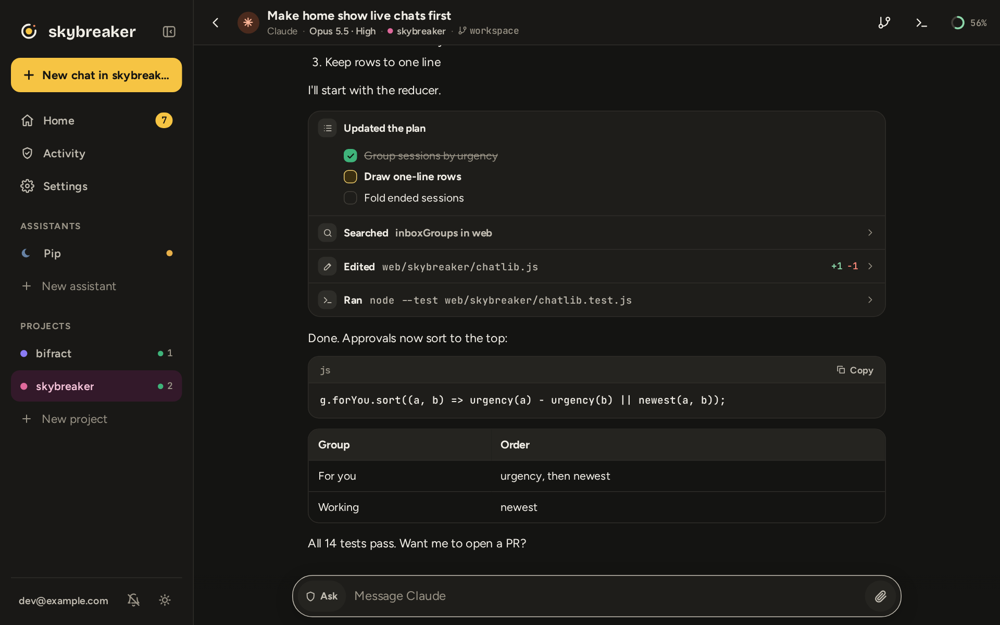

<p align="center">
  <picture>
    <source media="(prefers-color-scheme: dark)" srcset="https://raw.githubusercontent.com/zaneGittins/skybreaker/main/docs/img/banner-dark.png">
    
  </picture>
</p>

<p align="center">
  <b>Coding agents that never see your credentials.</b><br>
  Claude Code, Codex and pi in sandboxes on your own hardware, every request checked against your policy, driven from your phone, browser, terminal or VS Code.
</p>

<p align="center">
  <a href="LICENSE"></a>
</p>

<p align="center">
  <a href="docs/getting-started.md">Getting started</a> ·
  <a href="docs/using.md">Using it</a> ·
  <a href="docs/assistants.md">Assistants</a> ·
  <a href="docs/ARCHITECTURE.md">Architecture</a> ·
  <a href="docs/security.md">Security model</a> ·
  <a href="docs/development.md">Development</a>
</p>

---

Skybreaker runs Claude Code, Codex and pi in a gVisor sandbox per project on a Linux server you control. Every request an agent makes goes through a built-in broker that holds your credentials, checks the request against your policy and holds anything risky for your approval. You drive it over Tailscale from the web app, your phone, your terminal or VS Code. Your Claude and ChatGPT subscriptions work as they do in the vendors' own apps.

<p align="center">
  
  &nbsp;
  
</p>

## Features

- **Credentials stay out of reach.** The broker adds tokens on the way out, only to the hosts each one is bound to.
- **Deny by default.** Each request is allowed, held for your approval or refused, per project. Everything is audited, with a kill switch.
- **Chat anywhere.** Tool calls, diffs, approvals and questions inline, with push notifications when an agent needs you.
- **Terminal and VS Code.** Attach to any session in the agent's own terminal UI, or open its sandbox in VS Code.
- **Review and ship.** Each chat works on its own branch; read its diff, then have the agent open a pull request.
- **A board per project.** Agents pick up and hand back work through MCP tools.
- **Assistants.** A personal agent with no repo: memory you approve, scheduled routines, and a browser signed in to its own accounts whose logins it never sees.

## How it fits together

<p align="center">
  <picture>
    <source media="(prefers-color-scheme: dark)" srcset="https://raw.githubusercontent.com/zaneGittins/skybreaker/main/docs/img/architecture-dark.svg">
    
  </picture>
</p>

## Quick start

You need a Debian or Ubuntu server, a Tailscale tailnet with MagicDNS and HTTPS certificates on, and a GitHub account. On the server:

```sh
curl -fsSL https://github.com/zaneGittins/skybreaker/releases/latest/download/install.sh | sh
```

Then follow [Getting started](docs/getting-started.md) to connect GitHub and start your first chat.

Skybreaker is pre-1.0: a release may change the config file, and its notes say what to update.

## Docs

- [Getting started](docs/getting-started.md): install and first chat
- [Using Skybreaker](docs/using.md): chats, previews, boards, terminal, VS Code
- [Assistants](docs/assistants.md): make one, its memory, routines and browser
- [Configuration](docs/configuration.md): access to APIs, local models, sandbox limits
- [Upgrading](docs/upgrading.md) and [installing by hand](docs/manual-install.md)
- [Architecture](docs/ARCHITECTURE.md), [security model](docs/security.md) and [development](docs/development.md)

## License

Licensed under [AGPL-3.0](LICENSE). Contributions are welcome; see [CONTRIBUTING.md](CONTRIBUTING.md).
