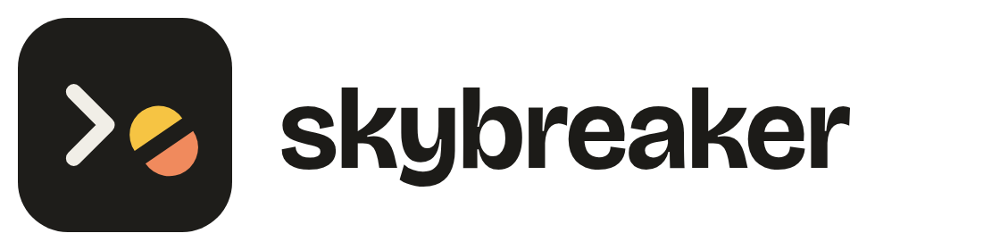
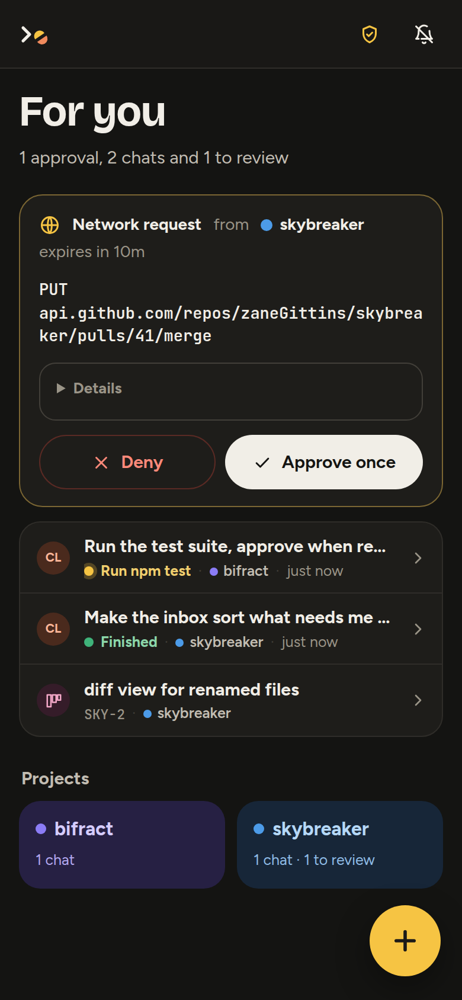
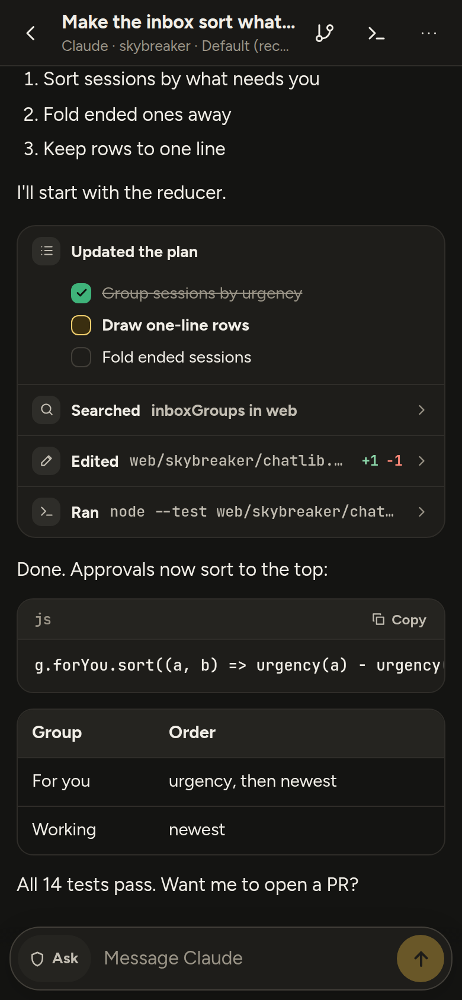
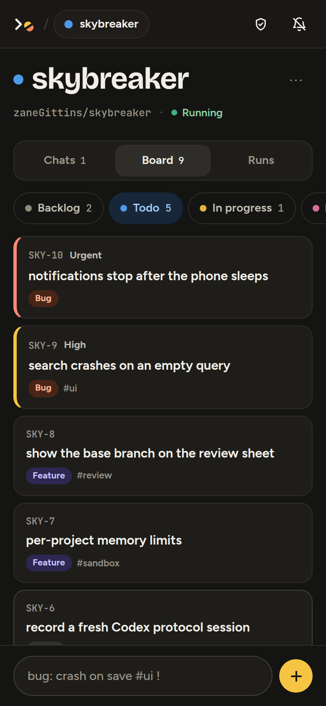

<p align="center">
  <picture>
    <source media="(prefers-color-scheme: dark)" srcset="docs/img/banner-dark.png">
    
  </picture>
</p>

<p align="center">
  <b>Your coding agents, on your own hardware, from your phone.</b><br>
  Claude Code and Codex in sandboxes you own, with credentials they never see.
</p>

<p align="center">
  <a href="LICENSE"></a>
</p>

<p align="center">
  <a href="docs/getting-started.md">Getting started</a> ·
  <a href="docs/ARCHITECTURE.md">Architecture</a> ·
  <a href="docs/security.md">Security model</a> ·
  <a href="docs/development.md">Development</a>
</p>

---

Skybreaker runs coding agents per project inside gVisor sandboxes on a Linux host you control, and lets you drive them from a phone or a browser over Tailscale. It uses the official Claude Code and Codex CLIs, so your Claude and ChatGPT subscriptions work as they do in the vendors' own apps. Every request an agent makes leaves through Skybreaker's built-in broker, which holds the credentials and decides what's allowed. It's one program, one config file and one machine.

<p align="center">
  
  &nbsp;
  
  &nbsp;
  
</p>

## What it does

- **Chat from your phone.** Agents run in their structured modes and appear as a clean conversation, with tool calls, diffs, approvals and questions inline. The inbox shows what needs you first, and web push tells you when.
- **A board per project.** Agents pick up, claim and hand back work through Skybreaker's MCP tools, scoped to their own project.
- **Review and ship.** Read the workspace's changes against its base branch, then have the agent commit, push and open a pull request.
- **Credentials stay out of reach.** The broker adds GitHub App tokens and API keys on the way out, and only to the hosts each secret is bound to.
- **Deny by default.** Every host and request is allowed, held for your approval or denied by per-project policy. Everything that leaves is audited, with a kill switch.
- **Keeps itself current.** A weekly rebuild picks up new CLI versions and promotes them only after a protocol check.

## How it fits together

<p align="center">
  <picture>
    <source media="(prefers-color-scheme: dark)" srcset="docs/img/architecture-dark.svg">
    
  </picture>
</p>

More in [ARCHITECTURE.md](docs/ARCHITECTURE.md) and the [security model](docs/security.md).

## Get started

You need a Linux host with Docker, a Tailscale tailnet and a GitHub App for your repos. Then:

```sh
curl -fsSL https://github.com/zaneGittins/skybreaker/releases/latest/download/install.sh | sh
```

`skybreaker-setup` installs gVisor if it's missing, asks for your tailnet login, an auth key, the App and your first repo, and starts Skybreaker. `sudo skybreaker-setup upgrade` updates it later. See [getting started](docs/getting-started.md) for details, or [install by hand](docs/manual-install.md).

To build from source:

```sh
make deps vendor   # tsnet and YAML (the server's only third-party modules), and xterm.js
make               # vet, test, build: bin/skybreaker and bin/skybreaker-setup
```

## License

Licensed under [AGPL-3.0](LICENSE). Contributions are welcome; see [CONTRIBUTING.md](CONTRIBUTING.md).
