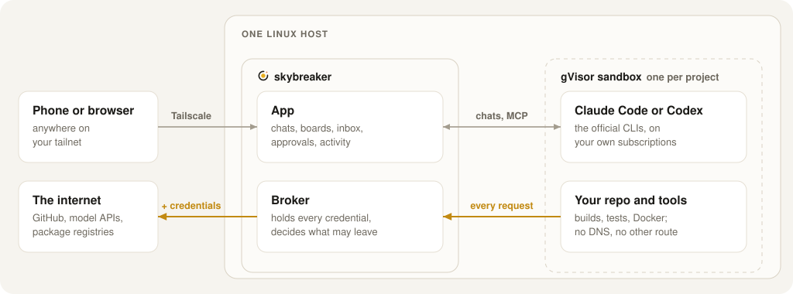
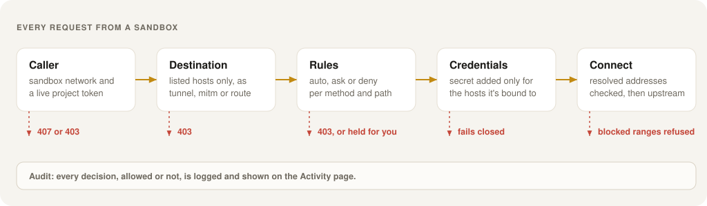

# Architecture

Skybreaker is one Go binary, `skybreaker`, running on one Linux host. It serves the app over Tailscale, runs a gVisor sandbox per project, and brokers every request those sandboxes make. The threat model is in [security.md](security.md).

  <picture>
    <source media="(prefers-color-scheme: dark)" srcset="img/architecture-dark.svg">
    
  </picture>

## Code map

| Path | Role |
|---|---|
| `cmd/skybreaker` | Entry point: `serve`, `check`, `nftables`, `version`. |
| `internal/control/controld` | Assembles the server; start here. |
| `internal/control/app` | Sandboxes, broker tokens, chats, terminals, review. |
| `internal/control/chat` | Harness drivers (Claude stream-json, Codex app-server), event log, process manager. |
| `internal/control/api` | The UI's HTTP API and server-sent events. |
| `internal/control/sandbox`, `netrules` | Container specs under `runsc`, and the nftables ruleset. |
| `internal/control/mcp`, `internal/board` | Skybreaker's MCP server and the per-project boards. |
| `internal/control/scheduler`, `hooks`, `terminal` | Scheduled runs, Claude Code hooks, WebSocket terminals. |
| `internal/control/preview` | Previews of a sandbox's web server, each on its project's own origin. |
| `internal/control/sshkeys` | SSH keys allowed into sandboxes, for VS Code. |
| `internal/proxy/broker` | The broker, assembled in-process. |
| `internal/proxy/server` | The request path: tunnel, MITM and routes. |
| `internal/proxy/policy`, `gitproto`, `graphql`, `k8s` | Rule matching, git push ref checks, GraphQL operations, Kubernetes attributes. |
| `internal/proxy/approval`, `secrets`, `netguard`, `audit` | Approvals, host-bound secrets, connect-time address checks, audit log. |
| `internal/tsauth` | Tailnet identity; `tsnetsrv` is the Tailscale adapter. |
| `internal/client` | The terminal client: session picker, attach, VS Code over SSH, self-update. |
| `web/` | The UI: plain JavaScript and CSS, embedded, no build step. |
| `setup/` | `skybreaker-setup`, the installer, in its own module. |
| `images/sandbox`, `deploy/` | The sandbox image, systemd units and example configs. |

The server uses the standard library except for two adapters: `tsauth/tsnetsrv` (Tailscale) and `configfile/yamlfmt` (YAML). Everything else is tested without them (`go test -tags nodeps ./...`).

## Request path

  <picture>
    <source media="(prefers-color-scheme: dark)" srcset="img/request-path-dark.svg">
    
  </picture>

1. **Caller.** The connection must come from a sandbox network, carrying a live token minted for that project. Tokens are rechecked on every request inside MITM connections, and revoked tokens' connections are closed.
2. **Destination.** The host must be in the project's `allow` list or capabilities. A **tunnel** splices bytes, **mitm** terminates TLS with the broker's CA, and a **route** is a reverse-proxy path on the broker.
3. **Rules.** The first matching rule decides `auto`, `ask` or `deny`; no match is a denial. Requests with their own credentials, impersonation headers, ambiguous paths (`..`, `//`, encoded slashes) and protocol upgrades are refused first. GraphQL rules parse the operation (`internal/proxy/graphql`) and Kubernetes routes the verb and resource. An `ask` is bound to a hash of the exact request, headers included, and held for approval.
4. **Credentials.** The token is checked again (it may have been revoked while held), then the broker strips placeholders and adds the secret, only if the secret lists the upstream host. Revoking a token also cancels its requests still in flight.
5. **Connect.** Resolved addresses are checked against loopback, link-local, metadata, private and tailnet ranges. Tailnet upstreams a route allows are dialled through Skybreaker's own Tailscale node.

## Projects

The config file is the base; the app adds to it from three files in `<data_dir>/settings` (`config.Paths`; the service can't write `/etc`): `projects.json` (projects created in the app), `access.json` (bundles made in Settings, and bundles and hosts added to any project) and `app-secrets.json` (secrets added in Settings, and the GitHub App created there, merged with the secrets file by `secrets.Merge`). Every change goes through `config.Edit`: it stages the files, loads the whole configuration from them, runs the broker's check (`broker.Check`) and only then renames them into place, returning the configuration before and after so the API can show what each project gains and loses (`ProjectPolicy.Reaches` and `DiffReaches` in `proxy/config`). `api/settings.go` serves the Settings page and the GitHub manifest flow (`githubapp.Manifest`, `Convert`); `controld`'s `settings` saves, audits (`broker.LogConfig`) and asks for a restart. Projects and policy fan out into the broker's compiled policy and secrets, sandbox networks, boards and previews, so Skybreaker restarts itself to apply a change (`controld.ErrRestart`, re-executed by `main`), once no chat is working. The nftables ruleset covers the whole sandbox range, so a new project needs no new rules.

## Sandboxes

Each project gets a long-lived `runsc` container, `skybreaker-<project>`, on its own bridge network. Its environment points `HTTPS_PROXY` at the broker on the bridge gateway, with no DNS and the broker's CA mounted. Starting a sandbox mints its token and revokes earlier ones.

The sandbox runs its own dockerd for builds and `docker compose`, storing images in the project's `docker/` directory on disk. Inner containers have no DNS either and reach the broker through the sandbox. A `runc` wrapper mounts the sandbox's CA bundle into every container and build step, so they trust the broker without image changes.

The host never reads sandbox-writable paths directly: workspaces, homes and inner Docker storage are never read, and scheduled runs' output is read through `os.Root`.

## Chats

A chat runs the harness's structured mode (`claude -p --output-format stream-json`, `codex app-server`) through `docker exec -i`. A `chat.Driver` translates each protocol into `chat.Event`s; the `Manager` stores them in a per-chat log and streams them to the UI over server-sent events. "Open in terminal" resumes the same conversation in tmux. Drivers never name models and ignore what they don't recognise; a weekly image rebuild promotes new CLI versions only if they still speak the protocols the drivers use.

## Previews

Each project has a preview origin, a port of Skybreaker's tailnet name assigned once (`store.PreviewPort`) and never reused for another project. `preview.Handler` serves it to listed users, proxying to the port you chose on the sandbox's fixed address (`sandbox.Addr`). It admits only its own origin's requests and navigations, namespaces cookies per project and strips CORS headers. The dev server sees itself addressed as `localhost`. The app lists the sandbox's listening ports from its `/proc/net/tcp`.

## Terminal client

Run without a server command, `skybreaker` is a client for your own machine. It finds the server through the local Tailscale and is known to it by your tailnet login, like the browser. It lists sessions from the inbox and attaches over the same WebSocket as the browser's terminal, switching a chat to its terminal first. A sandbox's bytes reach a real terminal emulator here, not xterm.js, so `client.Filter` drops every OSC, DCS, APC, PM and SOS string and C1 control before writing them.

## VS Code over SSH

Each sandbox runs sshd. `skybreaker vscode setup` makes the computer a key, adds it through `POST /api/ssh-keys` (`sshkeys.Store`, which rewrites it in canonical form) and puts a `Host *.skybreaker` block first in `~/.ssh/config`, whose `ProxyCommand` is `skybreaker ssh-proxy`. That carries ssh's bytes over a WebSocket to `/api/projects/{p}/ssh`, which starts the sandbox and relays to its sshd on `sandbox.Addr:22`. `app.SetAuthorizedKeys` writes the keys into every project's `etc/`, and sshd reads them on each login through `AuthorizedKeysCommand`. Deleting a key cuts the open relays.

## Boards and MCP

`board.Store` keeps every project's items in `board.json`. Skybreaker's MCP server exposes them to agents on the sandbox's hook listener, identified by network and hook token and scoped to their own project, and to you at `/mcp` on the app.

## Development

`TestUIDev` serves the real server with scripted harnesses and no sandboxes; see [development.md](development.md).
