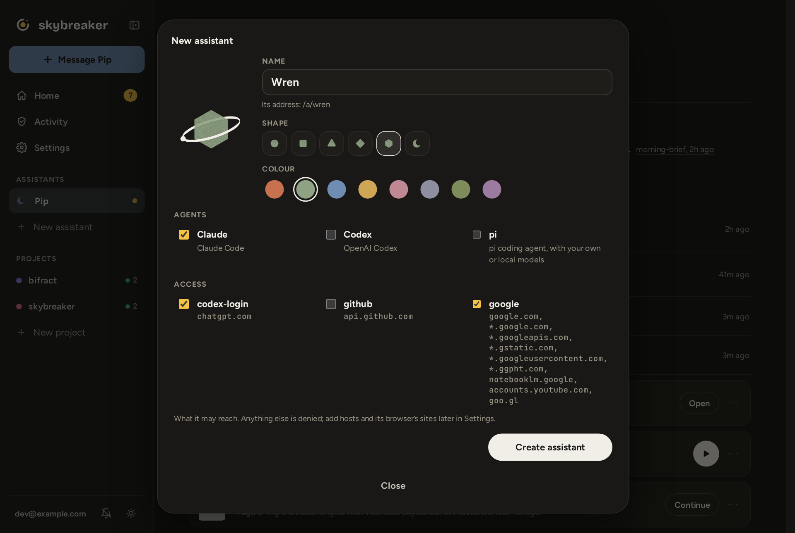
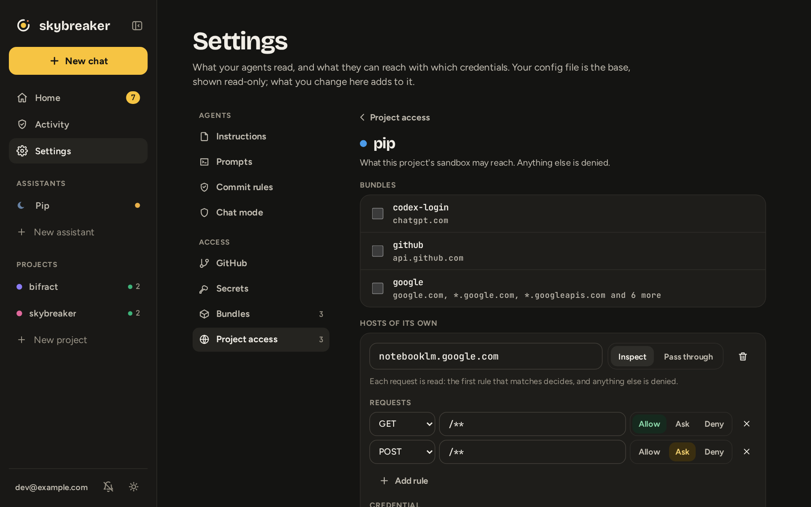
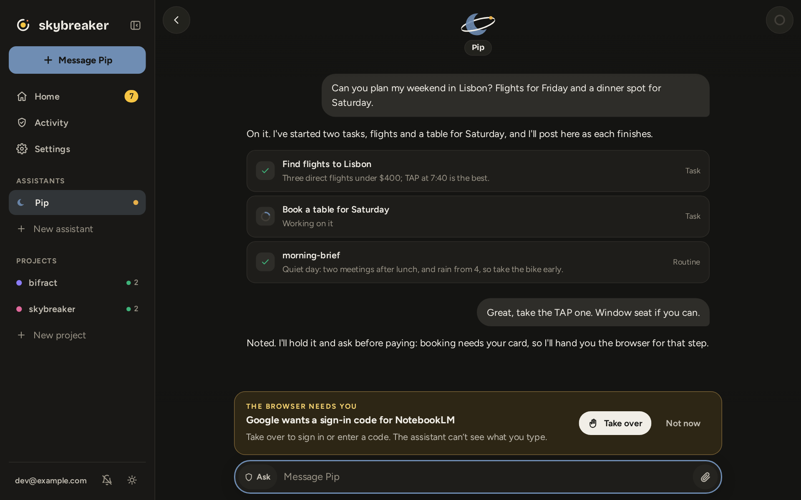
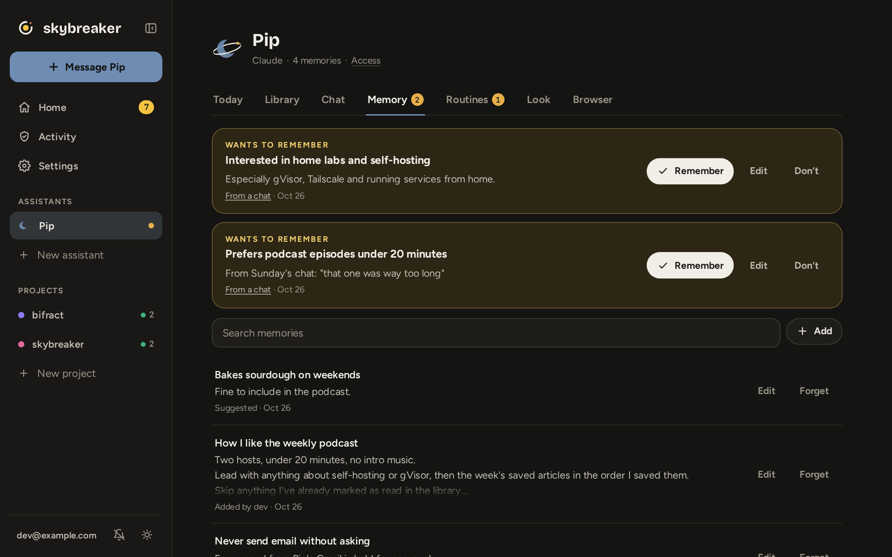
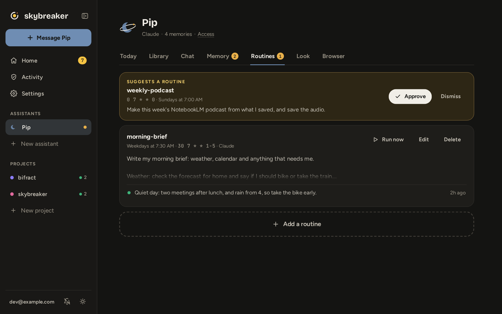
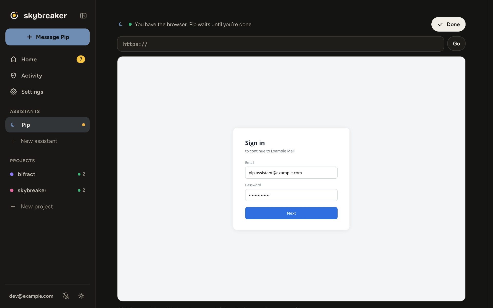

# Assistants

An assistant is an agent for everything that isn't a repo: your mail, calendar, bookings, research and briefs. It runs Claude, Codex or pi in a sandbox of its own, with the same broker and policy as a coding agent.

## Make one

Click **New assistant** in the sidebar. Give it a name, a shape and a colour, pick its agents, and tick the bundles it may reach. Skybreaker restarts to add it, once no agent is working.

## Choose what it reaches

Click **Access** under its name, or open **Settings → Project access** and pick it. Add bundles or hosts of its own, and make anything that writes `Ask`, so it waits for you. Its browser is held to the same rules.

## Talk to it

Tap the assistant, or **Message** it from the sidebar. You have one conversation, which picks up where you left off. Work that takes a while runs as a **task** in the background and shows as a card, so you can keep talking; open a card to follow it. Routine results arrive as cards too.

**Start fresh**, in the ring's menu, clears what the agent holds in mind but keeps its memories. Switch its **preferred** agent under **Look**, and its memory, personality and the conversation so far come along.

## Keep what it learns

It suggests things to remember as you talk. Nothing is kept until you click **Remember**. Edit or forget anything under **Memory**.

## Schedule work

Under **Routines**, click **Add a routine**, or **Approve** one it suggests. A routine is a schedule and a prompt, such as a weekday morning brief. A change applies when Skybreaker restarts, once no agent is working.

Routines and chats share its files, so give each routine its own folder.

## Sign it in to a site

Its browser has logins of its own, which the agent never sees. When a site wants a password, a code or a CAPTCHA, the conversation shows **The browser needs you**. Click **Take over**, sign in on the live page, then click **Done**. It waits until you're finished.

Give it accounts of its own, not yours.

## Also

- **Today** is its brief: what it did lately and anything waiting for you.
- **Library** keeps what it makes for you (podcasts, reports, PDFs, pages), with your place synced across devices. Audio plays on as you move around the app.
- **Look** sets its name, mark, agents and personality. Every saved personality is kept, so you can go back. Admins change its agents, and a change applies when Skybreaker restarts.

## How it works

An assistant is a project of kind `assistant`, with no repo. It gets its own sandbox and network, and every request leaves through the broker under its policy.

- **Memory and personality** live on the host, in `assistants.json`, never in the sandbox. They're added to every agent's instructions, so Claude, Codex and pi all read them.
- **MCP tools** let it `recall`, `propose_memory`, `propose_routine`, `post_update` and `start_task`. A proposal is only a card until you act on it.
- **The browser** is Chromium in a second container, driven over a pipe, with the profile mounted there alone. The agent gets high-level actions (open, read, click, type, scroll, screenshot, download, take over), not scripts, cookies or DevTools.

See [Architecture](ARCHITECTURE.md#assistants) for the details.

## Security

- **It proposes; you decide.** It can't keep a memory, schedule a routine or change its personality on its own.
- **It never types secrets.** Password, code and card fields are closed to it and blurred in screenshots, and account security pages are off limits. What you type when you take over goes to the browser only.
- **Pages it makes can't reach the app.** HTML in its library runs in a sandboxed frame with no network.
- **A signed-in browser can act as its account.** Rules narrow what it does but don't make an account safe to hand over.

See the [security model](security.md#assistants) for the rest, and [configuration](configuration.md#assistants) to define one in the config file.
