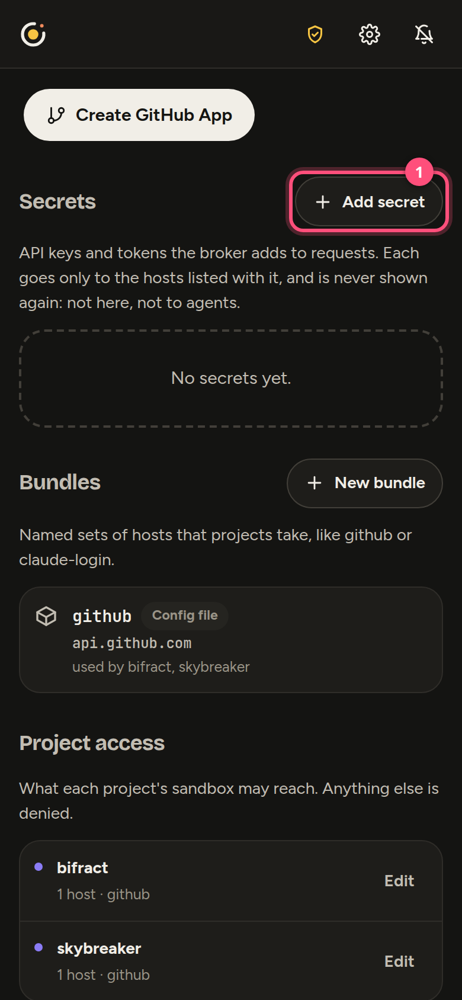
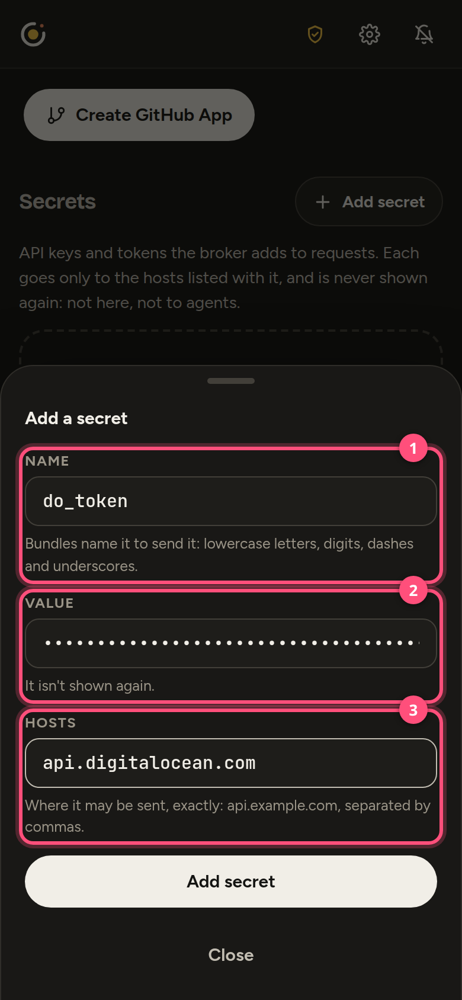
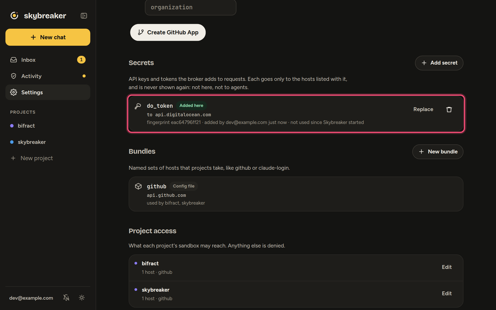
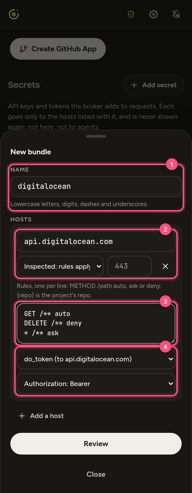
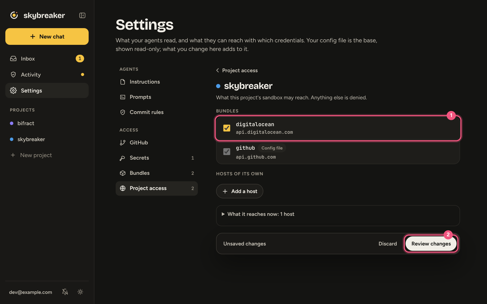
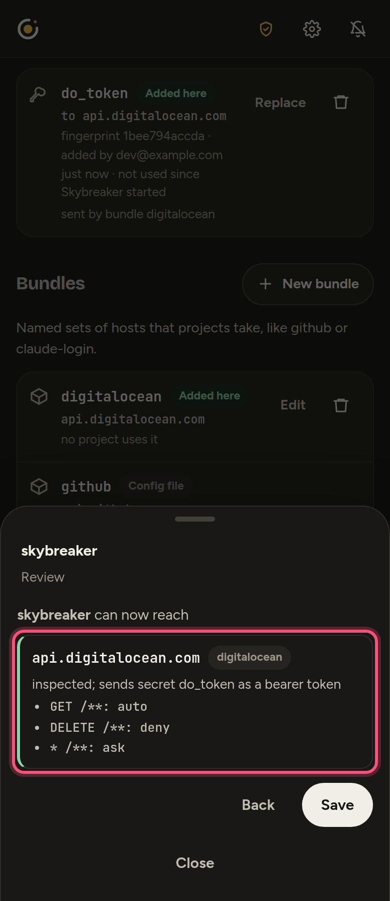
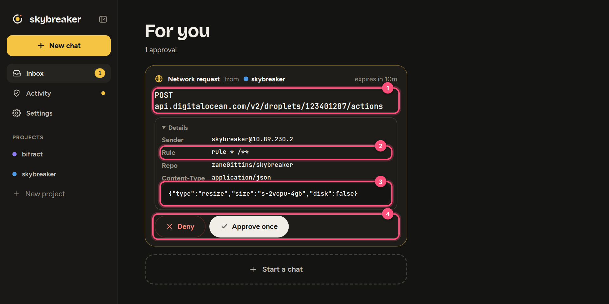

# Example: DigitalOcean

Give a project's agents the DigitalOcean API in three steps: a **secret** (your token), a **bundle** (where it goes and what's allowed) and a **grant** (which project gets it). The same steps work for any token-based API. The token never enters the sandbox; the broker adds it on the way out.

## 1. Make a token

In DigitalOcean: **API → Tokens → Generate New Token → Custom Scopes**. Grant only what agents need; scopes cap what any approval can do.

## 2. Add the secret

**Settings → Secrets → Add secret.**





1. **Name:** `do_token`
2. **Value:** your token (never shown again)
3. **Hosts:** `api.digitalocean.com` (the only place it can be sent)



## 3. Make the bundle

**Settings → Bundles → New bundle.**



1. **Name:** `digitalocean`
2. **Host:** `api.digitalocean.com`, **Inspect**
3. **Requests**, one rule a row (**Add rule** for more): `GET /**` **Allow**, `DELETE /**` **Deny**, and **Any** `/**` **Ask**. The first rule that matches decides.
4. **Credential:** `do_token`, **as a Bearer token**

**Review → Save.**

## 4. Grant it to a project

**Settings → Project access →** the project, tick **digitalocean**, **Review changes → Save.**





> [!IMPORTANT]
> Changes apply when Skybreaker restarts, which it does **once no agent is working**. A busy agent, even the one you want to use DigitalOcean, delays it.

## What agents can do

| Rule | Result | Examples |
|---|---|---|
| `GET` | Runs | List droplets, apps, databases, DNS; read logs and billing |
| `DELETE` | Refused | Destroy anything |
| Anything else | Waits for your approval | Create or resize droplets, power actions, redeploys, DNS and firewall edits |

The first matching rule wins; anything unmatched is denied. Drop the last rule for read-only.

Agents call the API with no token:

```sh
curl -sS https://api.digitalocean.com/v2/account
```

For `doctl` or SDKs that require a token, set this in the project's `env` (config file). The broker swaps it for the real one and refuses any other token:

```yaml
DIGITALOCEAN_ACCESS_TOKEN: skybreaker-injected
```

Changes show up as an approval card:



1. The request, as the broker parsed it
2. The rule that asked you
3. The body. Approval covers exactly this request.
4. Approve or deny

Not covered: SSH to droplets, Spaces (`*.digitaloceanspaces.com`), the container registry, and Kubernetes (a config-file route; see `k8s-prod` in [skybreaker.example.yaml](../deploy/skybreaker.example.yaml)).

## In the config file instead

`secrets.yaml` (token from `SKYBREAKER_DO_TOKEN` in `/etc/skybreaker/env`):

```yaml
secrets:
  - { name: do_token, kind: env, env: SKYBREAKER_DO_TOKEN, hosts: [api.digitalocean.com] }
```

`skybreaker.yaml`:

```yaml
capabilities:
  digitalocean:
    - host: api.digitalocean.com
      mode: mitm
      inject: { bearer: do_token }
      rules:
        - { match: "GET /**", action: auto }
        - { match: "DELETE /**", action: deny }
        - { match: "* /**", action: ask }

projects:
  myapp:
    capabilities: [github, digitalocean]
    env: { DIGITALOCEAN_ACCESS_TOKEN: skybreaker-injected }
```

Then `sudo systemctl restart skybreaker`. A name can't be in both the file and the app.

## Troubleshooting

| Error | Fix |
|---|---|
| `skybreaker: host is not on the project's allow list` | The restart hasn't happened (an agent is working), or the bundle went to another project. Check **Project access**. |
| `request carries its own credential in Authorization` | Use `skybreaker-injected` or no `Authorization` header. |
| `401` from DigitalOcean | Token expired or wrong. **Replace** it under **Secrets**. |
| `403` from DigitalOcean | The token's scopes don't allow it. |
