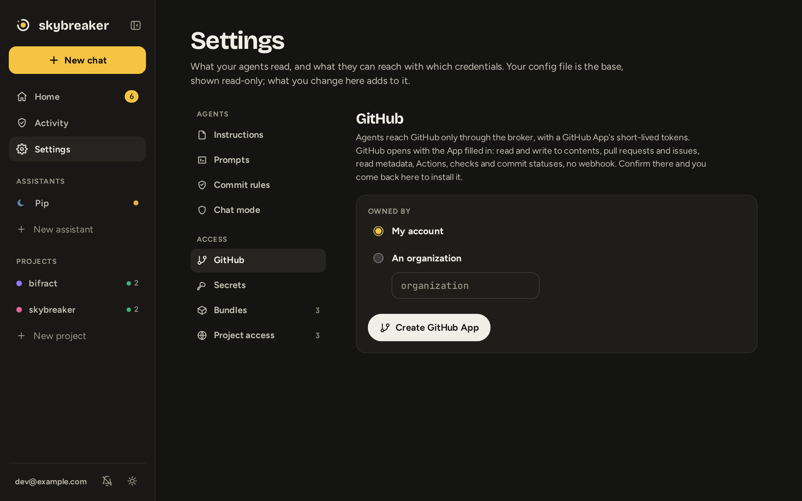
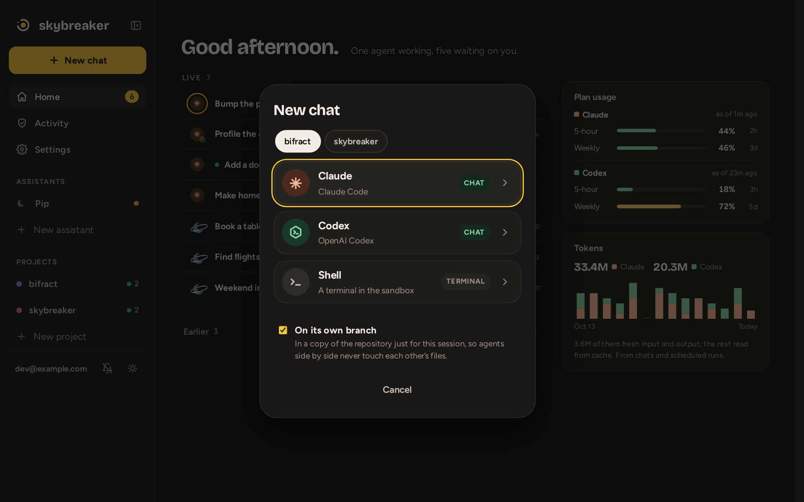

# Getting started

From a fresh server to your first agent chat in about ten minutes.

## You need

- **A Linux server.** Debian or Ubuntu, with about 4 GB of memory and a few cores for each project you run at once. A VM is fine.
- **A Tailscale tailnet** with **MagicDNS** and **HTTPS certificates** turned on (admin console → DNS).
- **A GitHub account or organization** that owns the repos your agents will work on.

## 1. Install

On the server:

```sh
curl -fsSL https://github.com/zaneGittins/skybreaker/releases/latest/download/install.sh | sh
```

The installer asks for your tailnet login, your tailnet name and your first repo. Leave the auth key and GitHub App fields empty. It installs Docker, gVisor and nftables if they're missing, starts Skybreaker, then prints a link: open it and approve the `skybreaker` machine on your tailnet.

Then, in the Tailscale admin console, turn off **key expiry** for `skybreaker`, so it doesn't drop off your tailnet later.

## 2. Connect GitHub

Open `https://skybreaker.<your-tailnet>.ts.net/settings/github` and click **Create GitHub App**. GitHub opens with the App filled in. Confirm, then install it on your repo when you're sent back.



Skybreaker keeps the App's private key; there's nothing to copy.

Then protect `main` on GitHub with a ruleset that blocks direct pushes, force pushes and deletion, and keep the App off its bypass list.

## 3. Start a chat

Click **New chat**, pick your project and an agent.



Sign in once per project, using your own subscription:

- **Claude:** open the chat's terminal and run `/login`.
- **Codex:** follow the sign-in code shown in the chat.

That's it. Each chat works on its own branch, and nothing it sends leaves without passing your policy.

## Optional

**Get notified on your phone.** Open Skybreaker on your phone, add it to the home screen, open it from there and tap the bell.

**Use your terminal.** On your laptop (Linux or macOS), no sudo needed:

```sh
curl -fsSL https://github.com/zaneGittins/skybreaker/releases/latest/download/install-cli.sh | sh
skybreaker    # pick a session and attach
```

**Install without questions.** Paste [deploy/cloud-init.yaml](../deploy/cloud-init.yaml) into a new server's user data, or run the installer unattended with a [Tailscale auth key](https://login.tailscale.com/admin/settings/keys):

```sh
sudo TS_AUTHKEY=tskey-auth-... skybreaker-setup install --yes \
  --login you@github --tailnet tail1234.ts.net --repo you/project
```

## If something goes wrong

| Problem | Fix |
|---|---|
| A step of the install failed | Fix the cause and run `sudo skybreaker-setup install` again. It picks up where it stopped. |
| You missed the approval link | `sudo skybreaker-setup status` shows it again. |
| TLS error opening the app | Turn on MagicDNS and HTTPS certificates. The first certificate can take a minute. |
| The installer says the name `skybreaker` is taken | Another machine on your tailnet has it. Pick another name with `--hostname`. |

## Next

- [Using Skybreaker](using.md): chats, branches, previews, boards, terminal and VS Code
- [Assistants](assistants.md): an agent for everything that isn't a repo
- [Configuration](configuration.md): give agents access to more APIs, local models, sandbox limits
- [Upgrading](upgrading.md) and [installing by hand](manual-install.md)
